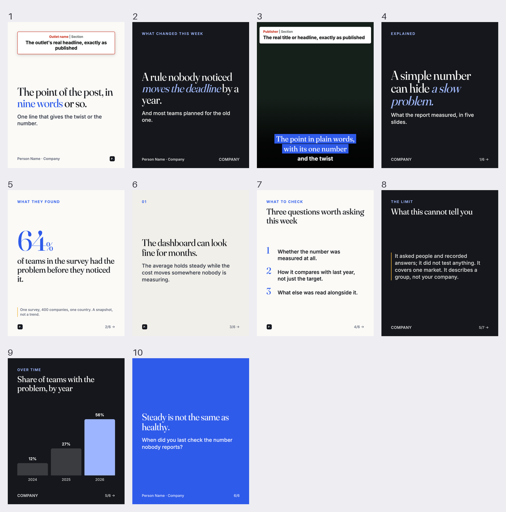

<h1 align="center">Content Manager</h1>

<p align="center"><b>LinkedIn posts, drafted in your brand, from what is actually happening in your field.</b><br>
Answer five questions. It reads your website for your colours, logo and fonts, watches the
news and the sources you care about, and every morning has post ideas waiting, each one a
click away from a finished draft with its image or carousel.</p>

<p align="center">
  <a href="https://lemma.work/import/github/ayushgautam-dev/content-manager"></a>
</p>

<p align="center">
  
</p>

---

## Why it exists

Posting well on LinkedIn is mostly the work before the writing: noticing the study, the
launch or the ruling that your audience should hear about, having a view on it, checking
the numbers, and making an image that does not look like everyone else's.

Content Manager does that part. It keeps one stream of ideas for you, each already
angled, with the evidence behind it:

> **Agent-written pull requests get merged 54.4% of the time. Human ones: 73.3%.**<br>
> *From a study · a carousel · why now: published this week*

Press **Write this post** and the writer drafts it, lists every source a claim rests on,
and designs the image or carousel in your brand. You read it, ask for a change, approve.

**It drafts, you approve.** Nothing is ever posted for you.

## What a morning looks like

- **Ideas**: about five posts worth writing today, from your sources, the news in your
  field and your own story. One button each: *Write this post*.
- **The brief**: before anything is written, one optional box: your opinion, an angle,
  "make it a carousel", "also look into what the regulator said".
- **Drafts**: the post as LinkedIn will show it, on desktop or phone, editable in place.
  Check the sources and their limits, ask for a change, approve.
- **Your sources**: one tab per thing you asked to have watched (*Studies*, *Launches*,
  *Rulings*, *Funding*…), each item read and scored before you see it.
- **News**: the handful of stories in your field worth a view right now.
- **Voice**: what the writer knows about how you write. Read-only; you change it by
  telling the writer.
- **Ask the writer**: "make this shorter", "follow EU AI regulation too", "use a darker
  cover". It changes the draft, your sources or the templates.

## How it works

```
  your website · the news in your field · the sources you asked for
            │
            ▼
   ┌───────────────────────┐   reads your site for colours, logo and fonts;
   │  setup  (once)        │   writes your news topics and sources, each with
   └──────────┬────────────┘   its own standard; rules for your field; first notes
              ▼
   ┌───────────────────────┐   fetches new items and keeps only what meets the
   │  screener · scout     │   source's standard; groups the news into stories;
   │  (each morning)       │   writes about five post ideas
   └──────────┬────────────┘
              ▼
   ┌───────────────────────┐   drafts the post, cites every claim, designs and
   │  writer               │   renders the image or carousel in your brand
   └──────────┬────────────┘
              ▼
   ┌───────────────────────┐
   │  you                  │   change · approve · post it yourself
   └───────────────────────┘
```

**Your brand, read from your site.** Setup opens your website in a real browser, weighs
every colour by how much of the page it covers, finds your logo, and checks your fonts
against Google Fonts, swapping licensed ones for the closest open match. The slides and
the app itself switch to that look.

**Sources are data, not code.** "New research on developer productivity", "launches from
the tools we compete with", "court rulings on data privacy": each becomes a row with its
own search terms (PubMed, Europe PMC, ClinicalTrials.gov, arXiv, RSS, Google News, or web
search) and its own standard for what is worth keeping. Tell the writer to add one and a
new tab appears.

**Honest by construction.** Every number on a draft traces to a source you can click.
Nothing is stated more strongly than its source; a single study carries its limit; a
preprint is called a preprint. Fields with rules of their own (health, finance, law…) get
a sector-rules file at setup, and the writer follows it.

**Writes like a person from day one.** Every draft goes through a rewrite pass before
you see it: the writer marks the patterns that make text read as AI (staged reveals,
not-X-but-Y contrasts, one-line closers, sayings that only sound deep, triads, the 2026
LinkedIn idiom), rewrites, re-reads and checks it did not over-correct. The guide combines
[humanizer](https://github.com/blader/humanizer), the LinkedIn humanizer and post writer
from [linkedin-skills](https://github.com/sergebulaev/linkedin-skills), and Wikipedia's
*Signs of AI writing*. Once you have voice notes, your voice wins on style; every edit
you make teaches it more.

## Install and remix on Lemma

<p>
  <a href="https://lemma.work/import/github/ayushgautam-dev/content-manager"></a>
</p>

Press the button, then open the app. Its first run asks five questions, one to a page:

1. your company's website;
2. your LinkedIn profile (your company page is optional);
3. what you write about;
4. what you want brought to you each day;
5. anything else.

Setup then takes about ten minutes, and you can watch it: *picking up your colours and
logo*, *setting up what to watch for you*, *checking the rules for your field*, *writing
first notes about you*. The last page offers **Find my first ideas**.

No key is needed for any of it.

<details>
<summary>Set it up with an agent, or from a terminal</summary>

Paste [SETUP-PROMPT.md](SETUP-PROMPT.md) into a fresh pod's chat and the pod's own
assistant does the rest. Or:

```bash
git clone --depth 1 https://github.com/ayushgautam-dev/content-manager && cd content-manager
LEMMA_POD_ID=<pod> ./setup.sh
```

[`setup.sh`](setup.sh) imports everything with its files, names the pod, checks every
agent and function kept its permissions, and ends with a note telling whoever ran it what
to say next. About two minutes.

</details>

### Make it sound like you (optional)

A quiet card on the Ideas page: press **Set it up** and Studio starts a chat with
Lemma's own assistant and opens it, already working. The assistant follows
[`files/guide/voice-setup.md`](files/guide/voice-setup.md):

- **Free:** paste ten or more of your posts, or upload screenshots, and it writes your
  voice notes from them.
- **Fetched:** if you would rather not copy them, it walks you through getting a key
  from a scraper service ([Monid](https://monid.ai), recommended, about $0.27 for 60
  posts; or [Apify](https://apify.com), which has free monthly credits), tells you the
  cost before it runs, and builds your notes from your own posts. Photos for image posts
  come only from posts you published yourself.

**Keys never go in a chat.** You add the key in Lemma itself (your pod's About page →
Connectors → OpenAPI), where it is stored encrypted, never shown back, and used only for
you.

### Daily runs

The morning runs (`daily-sources`, then `daily-radar`) are imported switched off. Turn
them on in `schedules/` (set `is_active`, and the `cron` and `timezone` you want) and
re-import, or ask the pod's assistant to switch them on. Until then, *Find new ideas* and
*Check for new…* run them on demand.

## Make it yours

1. [Fork the repository](https://github.com/ayushgautam-dev/content-manager/fork).
2. Change how it writes ([`files/playbook/`](files/playbook)), the slide look and layouts
   ([`files/brand/`](files/brand)), the agents ([`agents/`](agents)), the tables or the
   app.
3. Import your fork with `https://lemma.work/import/github/<you>/<your-repo>`.
4. When it is useful, [show your version here](https://github.com/ayushgautam-dev/content-manager/issues/new?template=show-your-version.yml&title=%5BRemix%5D+).

The app ships built, so an import needs no build and nothing configured. To change it,
edit its project and rebuild:

```bash
cd studio && npm install && cp .env.example .env.local && npm run dev
./studio/build.sh                          # rewrites apps/studio/source/
```

`build.sh` clears every `VITE_LEMMA_*` setting and moves `.env` files aside first (Vite
would otherwise bake your pod's id into the build) and refuses to write output that
contains one. [AGENTS.md](AGENTS.md) covers what each part is for and what has broken
before.

## What is in here

| | |
|---|---|
| **tables** | `founders` (each person and their answers) · `setup_jobs` (the progress page) · `sources` and `source_items` (what each person follows, and what was kept) · `topics`, `signals`, `trends` (the news) · `sparks` (ideas) · `drafts` · `ideas` (notes) |
| **functions** | `fetch_items` (papers and feeds, using each source's own terms) · `scan_sources` (Google News per region, Reddit) · `fetch_linkedin_posts` (optional, through the person's own key; ships with none) |
| **agents** | `setup` (brand, sources, sector rules, first notes) · `screener` (applies each source's standard) · `scout` (stories and ideas) · `writer` (drafts, slides, revisions, learning) |
| **schedules** | `daily-sources` and `daily-radar` (off) · `learn` (on: every approval or removal teaches the writer) |
| **files** | `/playbook` (honesty rules, angles, the default style) · `/brand` (slide styles, Studio theme, renderer, website reader, layouts) · `/guide` (the voice guide for Lemma's assistant) |
| **apps** | `studio`, shipped built. Its project is `studio/`. |

## Known limits

- **Your website has to load in a browser.** A site behind a login or a bot wall gets
  the neutral look until you tell the writer your colours.
- **LinkedIn cannot list your past posts** to any app, Lemma's included. Voice notes come
  from posts you paste, or from a scraper with your own key.
- **Nothing is posted.** You copy the text and download the image or PDF; there is no
  LinkedIn posting or analytics.
- **Screening reads titles and abstracts**, not full papers.

## Share

<p>
  <a href="https://twitter.com/intent/tweet?text=Content%20Manager%3A%20LinkedIn%20posts%20drafted%20in%20your%20brand%2C%20from%20what%20is%20actually%20happening%20in%20your%20field.&amp;url=https%3A%2F%2Fgithub.com%2Fayushgautam-dev%2Fcontent-manager"></a>
  <a href="https://www.linkedin.com/sharing/share-offsite/?url=https%3A%2F%2Fgithub.com%2Fayushgautam-dev%2Fcontent-manager"></a>
</p>

Built with [Lemma](https://lemma.work) · [MIT licensed](LICENSE), except
`files/playbook/human-writing.md` (CC BY-SA 4.0, with credits to humanizer,
linkedin-skills and Wikipedia)
